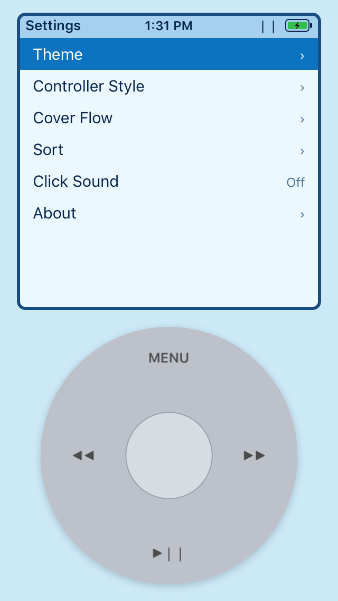
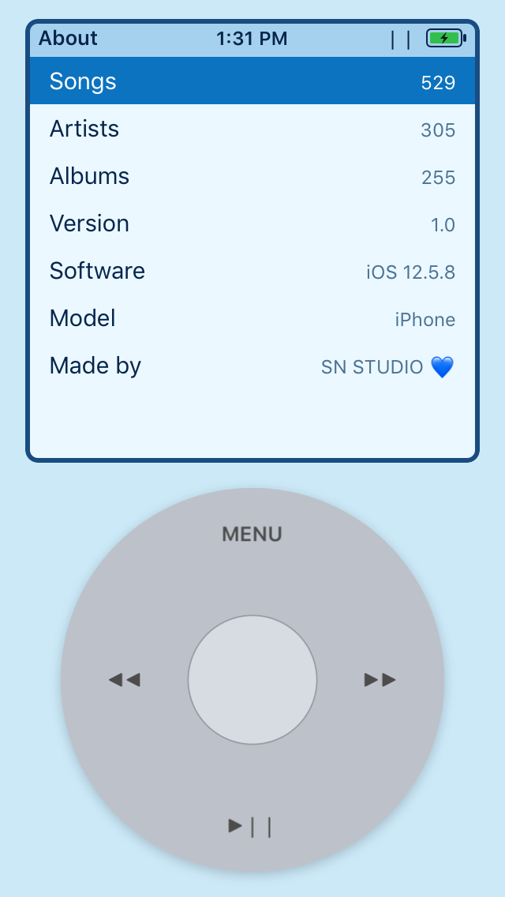

# iPodApp

A classic iPod-style music player for iPhone, written in Swift with UIKit. It has a menu screen, a touch **click wheel**, **Cover Flow**, a built-in **Brick Game**, and plays the music already stored on your device through Apple's `MediaPlayer` framework.

Built to run on older devices (works on iPhone 5s / iOS 12) and fill the whole screen.

Made by **SN STUDIO** 💙

## Screenshots

| Main menu | Cover Flow | Settings | Brick Game | About |
| :---: | :---: | :---: | :---: | :---: |
|  |  |  |  |  |

## Features

- **Click wheel**: rotate to scroll, press the center to select, MENU to go back, plus play/pause, previous and next buttons
- **Library browsing**: Playlists, Artists, Albums and Songs
- **Line list or Cover Flow**: choose per category (Songs, Artists, Albums, Playlists) whether it opens as a list or as 3D Cover Flow
- **Sorting**: A-Z, Z-A or Recently Added, applied to every list
- **Shuffle Songs** and a **Now Playing** screen with artwork, title, artist, album, progress bar and time remaining
- **Volume control**: turn the wheel on the Now Playing screen to change the volume (follows the hardware volume buttons too)
- **Seek**: press the center on the Now Playing screen to switch the wheel between Volume and Seek
- **Brick Game**: a Breakout game played with the wheel (Extras → Brick Game)
- **10 screen themes**: Classic, Dark, Green, Rose, Ocean, Sunset, Purple, Gold, U2 Red, Matrix
- **8 wheel styles**: White, Black, Silver, Red, Gold, Blue, Pink, Green
- **Click sound** on/off
- **Clock and battery icon** in the title bar (time centered, battery on the right, green with a bolt while charging)
- Your theme, wheel, view, sort and sound choices are saved between launches
- Fullscreen layout with a launch screen, so there are no black bars on 4" iPhones

## Controls

| Action | What it does |
| --- | --- |
| Rotate wheel | Scroll the menu or Cover Flow. On Now Playing: change volume or seek. In Brick Game: move the paddle |
| Center button | Select the highlighted item. On Now Playing: switch between Volume and Seek. In Brick Game: launch / pause / restart |
| MENU (top) | Go back |
| Play/Pause (bottom) | Toggle playback |
| Next (right) | Skip to the next song |
| Previous (left) | Restart the song if more than 3 seconds in, otherwise go to the previous song |

## Menu structure

```
iPod
├── Playlists
├── Artists
├── Albums
├── Songs
├── Now Playing
├── Shuffle Songs
├── Extras
│   └── Brick Game
└── Settings
    ├── Theme
    ├── Controller Style
    ├── Cover Flow   (Songs / Artists / Albums / Playlists: In Line or Cover Flow)
    ├── Sort         (A-Z / Z-A / Recently Added)
    ├── Click Sound
    └── About (song / artist / album counts, version, iOS version, model, SN STUDIO)
```

In **Settings → Cover Flow**, press the center on a row to switch it between *In Line* and *Cover Flow*.

## Requirements

- iPhone with iOS 12.0 or later (arm64, so iPhone 5s and newer)
- Music stored on the device (synced or downloaded)
- Permission to access Media & Apple Music (the app asks on first launch)

## Project layout

```
.
├── project.yml                  # XcodeGen project definition
├── screenshots/                 # README images
├── .github/workflows/build.yml  # GitHub Actions: builds an unsigned IPA
└── Sources/
    ├── AppDelegate.swift        # App entry point, audio session
    ├── iPodViewController.swift # Menus, Now Playing, themes, volume, playback, settings
    ├── ClickWheel.swift         # Touch click wheel and wheel styles
    ├── CoverFlowView.swift      # 3D Cover Flow for songs, artists, albums, playlists
    ├── BrickGameView.swift      # Breakout game
    └── LaunchScreen.storyboard  # Launch screen (enables fullscreen on all iPhones)
```

The Xcode project is generated from `project.yml` with [XcodeGen](https://github.com/yonaskolb/XcodeGen), so there is no `.xcodeproj` checked in.

## Building

### On GitHub (no Mac needed)

1. Push the repo to GitHub.
2. The **Build IPA** workflow runs on every push (or start it manually from the **Actions** tab).
3. When it finishes, download the `iPodApp-ipa` artifact. It contains `iPodApp.ipa`.

### On a Mac

```bash
brew install xcodegen
xcodegen generate
open iPodApp.xcodeproj
```

Then pick your device and run from Xcode.

## Installing the IPA

The IPA built by GitHub Actions is **unsigned**, so it can't be installed directly. Sign and install it on your phone with a sideloading tool such as AltStore or Sideloadly, using your own Apple ID.

## Notes

- The app uses `MPMusicPlayerController.applicationMusicPlayer`, so it has its own queue and doesn't take over the Music app.
- Songs, Artists and Albums are built from all audio in the library (music, podcasts, audiobooks, imported audio). Items that are only in iCloud and not downloaded will be listed but can't play offline.
- Portrait orientation and iPhone only.

## License

Add a license of your choice (for example MIT) before publishing.
